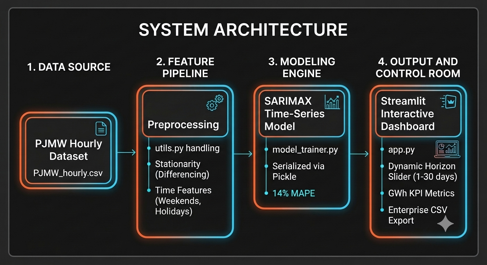

# ⚡ PJMW Regional Grid: Predictive Load Forecasting Dashboard

An end-to-end, interactive machine learning dashboard that generates live, out-of-sample energy demand forecasts for the PJM Western Region grid. Powered by a **SARIMAX** time-series model and built using **Streamlit**.

## System Architecture 

<div align="center">
  
</div>

## 💡 Business Context & Ecosystem Impact

### The Core Problem
Power grid operators face a continuous balancing act: 
* **Underestimating demand** forces grid operators into expensive, emergency spot-market energy purchases or risks local brownouts.
* **Overestimating demand** leads to fuel waste, unnecessary wear on generation assets, and severe financial inefficiencies.

### Target Users & Workflow
1. **Grid Dispatchers & Energy Traders:** Use the dynamic peak load metrics (e.g., tracking peak demand spikes) to purchase bulk power in advance on wholesale markets, avoiding expensive spot-market price spikes.
2. **System Reliability Engineers:** Inspect the hourly demand timeline and export downloadable CSV forecasts to plan infrastructure maintenance windows during low-demand baseline periods.

### Key Performance Indicators (KPIs)
* **Forecast Precision:** Maintaining a reliable **14% MAPE** on out-of-sample data to keep reserve margins tight.
* **Cost Optimization:** Minimizing reliance on high-cost peaking power plants through early capacity planning.

## 📊 App Features
- **Dynamic Horizon Simulation:** Move the sidebar slider to instantly generate forecasts from 1 to 30 days out-of-sample forecast.
- **Live Feature Pipeline:** On-the-fly engineering of time-based features, including weekends and structural calendar cycles, matching the training pipeline.
- **Control Room UI:** Dark-themed operational interface complete with dynamic KPI metrics scaled to GWh, an interactive trend line profile, and an expandable raw data viewer.
- **Enterprise Export:** Built-in data export engine allowing grid operators to download forecasted profiles cleanly as a CSV.

## 🛠️ Tech Stack & Architecture
- **Frontend/Dashboard:** Streamlit
- **Time-Series Modeling:** SARIMAX (`statsmodels`)
- **Data Processing & Feature Engineering:** Pandas, NumPy, Holidays
- **Model Serialization:** Pickle

## Project Structure
```text
├── .streamlit/ 
    └── config.toml                          # Basic Configuration of streamlit
├── Jupyter Notebook/
    ├── Forecasting_Energy_Demand.ipynb      # Jupyter Notebook
├── assets/
    └── forecast_architecture.png            # System Architecture
├── dataset/ 
    └── PJMW_MW_Hourly                       # Dataset for model training
├── model/                                   # Folder to store trained model 
├── app.py                                   # App logic
├── model_trainer.py                         # Model training code 
├── utils.py                                 # Frequently used functions
├── requirements.txt                         # Python dependencies
└── README.md                                # Project documentation
```

## 🚀 Local Setup Instructions

1. Clone this repository.
2. Install dependencies:

   pip install -r requirements.txt

3. Upload the [PJMW_Hourly Dataset](https://www.kaggle.com/datasets/robikscube/hourly-energy-consumption?select=PJMW_hourly.csv) to "dataset" folder

4. Run the model_trainer.py file to train the model:

   python model_trainer.py

5. Run the Streamlit application:

   streamlit run app.py
